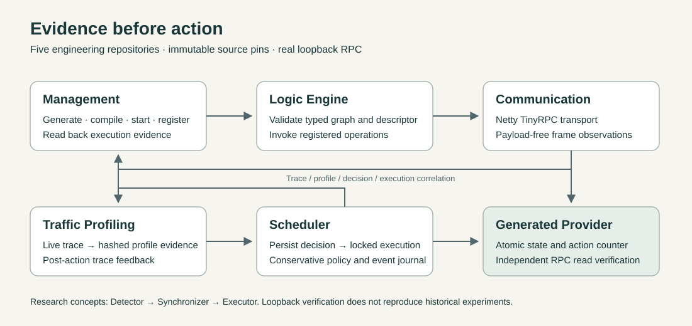

# Smart Home Edge Computing System

A source-pinned integration hub for independent research on smart-home service
communication, typed logic execution, traffic profiling, scheduling, and local
management. Five repositories preserve their own history; this Hub owns the
integration contracts and reproducible system runner.

| Component | Source repository |
| --- | --- |
| Smart Home Communication | [Communication](https://github.com/David-Lee-11101/Smart-Home-Communication) |
| Logic Engine | [Typed execution](https://github.com/David-Lee-11101/SmartHome-Logic-Engine) |
| Traffic Profiling | [Traffic models](https://github.com/David-Lee-11101/SmartHome-Traffic-Profiling) |
| Thread-Safe Scheduler | [Evidence-aware execution](https://github.com/David-Lee-11101/SmartHome-ThreadSafe-Scheduler) |
| Integrated Logic Management | [Management and generation](https://github.com/David-Lee-11101/SmartHome-Integrated-Logic-Management) |

The manifest pins tested production source commits. Later CI-only commits can retain
the same production source; a branch's latest metadata is not a dependency upgrade.

## Verified capabilities

| Capability | Implemented and verified scope |
| --- | --- |
| Communication | Bounded Netty TinyRPC, typed values, deadlines and payload-free frame telemetry |
| Logic Engine | Validated typed DAG execution and exact executed-definition readback |
| Traffic Profiling | Deterministic trace calibration/classification and explicit uncertainty |
| Scheduler | Evidence policy, persisted decisions, ordered locks and execution events |
| Management | Confined generation, compilation, live provider lifecycle and evidence readback |
| System integration | Actual causal loopback execution with independent state/count reads and action feedback |

The completed cold-source engineering cohort at Hub
[`2d07649`](https://github.com/David-Lee-11101/SmartHome-Edge-Computing-System/commit/2d07649bbd4a5aab248569df3c4922daa6d41920)
passed **81 command checks, 51 artifact hashes and zero skips**. It binds
Communication `83ffe6d`, Logic `971693b`, Profiling `143a256`, Scheduler `ab29ac2`
and Management `ae5028b`. Later source changes require their own exact-source proof;
this cohort is retained with its original identities. Publication acceptance binds
the final manifest to a newly generated proof, rather than relabeling this result.
The [Releases page](https://github.com/David-Lee-11101/SmartHome-Edge-Computing-System/releases)
is the publication location for sanitized exact-source proof receipts and source
previews. A receipt identifies its checked-out Hub and component commits; downloaded
evidence must be interpreted at those identities.



## Reproduce the integration

Requirements: Git and access to pinned repositories, JDK 21, Maven, Node.js/npm and
Python 3. Dependency downloads require network access. The runner uses fresh source
checkouts and a fresh Maven repository.

```bash
python3 tools/validate_contracts.py
python3 -m unittest discover -s tests -v
python3 tools/run_cold_system.py --workspace /tmp/smarthome-cold-run
```

Choose a new, nonexistent workspace. The runner fetches exact commits from
[components.json](components.json), builds and tests the components, generates and
compiles a stateful virtual switch, starts it on loopback and registers its typed
descriptor. A validated Logic Engine graph invokes actual Netty TinyRPC; payload-free
frame observations produce profile evidence before the scheduler persists a decision
and performs authorized actions. Separate RPC reads prove state and count changes.
Management reads back actual logic, profile, decision and execution records. A
post-action trace also returns to the profiler. Every actual action is separately
correlated with its trace/session/request tuple, completed execution event and real
profiler feedback.

Outputs: `system-proof.json`, local command logs, generated sources and
`runtime/evidence/`. Any failed build or causal assertion produces a failed proof and
nonzero exit status. Saved proof snapshots and canonical fixtures never drive runtime.

## Evidence and limits

| Check | Evidence |
| --- | --- |
| Source identity | Clean checkouts at immutable commits |
| Real transport | Instrumented encoded frame lengths and directions |
| Profile before policy | Actual trace and model references |
| Decision before action | Durable decision read by actual callback |
| Actual effects | Independent readEnabled/readActionCount calls |
| Conservative policy | Controlled anomaly, ambiguity and conflict probes |
| Feedback | Execution records, management readback and profiler feedback |

The model calibrates on one local read and classifies a fresh read. This proves
software integration, not physical-device classifier accuracy. Policy probes explicitly
modify evidence to test decision sensitivity; these are controlled counterfactuals,
not claims that anomalies or conflicts were detected in a home. The normal action
uses unchanged evidence produced by the profiler.

Post-action diagnostics remain separate from authorization. A model calibrated on
reads can classify action traffic as `unknown-profile`, anomalous and zero confidence;
the runner preserves those outputs. It does not assign a normal label to make the
integration appear successful. Final state and action count are proved through
independent RPC reads, rather than inferred from classification.

See [integration API](contracts/INTEGRATION_API.md),
[compatibility policy](contracts/COMPATIBILITY.md) and [runner notes](docs/RUNNER.md).

## Research boundaries

The research manuscript's three conceptual components are **Detector → Synchronizer
→ Executor**. The five repositories are a distinct engineering decomposition. New
loopback verification does not reproduce historical experiments or validate reported
device measurements. Historical code remains provenance. arXiv work is planning only;
no submission or publication is asserted.

| Paper concept | Engineering responsibilities | Evidence boundary |
| --- | --- | --- |
| Detector | Communication observations and Traffic Profiling | Live frame profiling is verified; historical event/rule inference and CRI results are not reproduced |
| Synchronizer | Thread-Safe Scheduler policy, locks and conditions | Current software scheduling is verified; historical traffic-layer Monitor experiments remain separate |
| Executor | Logic Engine calls through Communication to generated providers | Actual virtual-provider effects are verified; physical-home execution is not asserted |
| Supporting workspace | Integrated Logic Management and its generator | Engineering tooling that manages definitions, services and evidence; not a fourth paper component |

Contracts and the runner are implemented. Integration capability requires a passed
run at the manifest commits. Independent review and publication remain separate gates.
The manifest's visibility describes the recorded repository state; accepting a public
manifest does not itself perform or authorize publication. Source-equivalence evidence
can identify unchanged production files across documentation or CI-only commits, and
the final proof still records the commits it actually checks out. See
[production/publication equivalence](docs/PRODUCTION_EQUIVALENCE.md) for the exact
runtime, benchmark and test boundaries.

## Rights

Source visibility grants no reuse license for owner-authored material. Third-party
notices and historical provenance remain intact. See [RIGHTS.md](RIGHTS.md).
