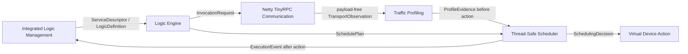

# Smart Home Edge Computing System

An integration hub for research on lightweight smart-home service communication, typed logic execution, payload-free traffic profiling, evidence-aware scheduling, and local logic management.

> Status: the contract catalog is being verified. Component implementations retain their own history, and the cold-source end-to-end proof has not passed yet.



## Capability state

| Area | Current state |
| --- | --- |
| Contract catalog and canonical fixtures | Verified component work in progress |
| Historical component implementations | Historical, under governance |
| Cross-component adapters | Experimental |
| Cold-source causal system proof | Future until the exact-head runner passes |
| Revised research manuscript | Local research work; publication status is not asserted here |

The architecture intentionally uses independent repositories plus an immutable component manifest. This Hub is a normal Git repository and does not use submodules.

## Contract workflow

```bash
python3 tools/validate_contracts.py
python3 -m unittest discover -s tests -v
```

See [the integration API](contracts/INTEGRATION_API.md), [compatibility policy](contracts/COMPATIBILITY.md), and [system flow](architecture/system-flow.mmd).

## Research boundaries

Transport traces contain encoded frame length, direction, relative monotonic timing, and correlation identifiers. They do not contain message payloads, credentials, home addresses, device identities, or packet-capture claims. Historical experiments and newly verified engineering are reported separately.

## Rights

Source visibility does not grant reuse permission. See [RIGHTS.md](RIGHTS.md).
